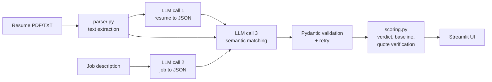

# Resume Analyzer & Job Matcher

An NLP application that uses a Large Language Model (Groq API, `openai/gpt-oss-120b`) to extract structured information from a resume and a job description, then performs **semantic, evidence-backed matching** between the two.

Demo Link: https://resume-analyzer-job-matcher-ukkb4u58rudgdyewra24tr.streamlit.app/

## What it does

Paste or upload a resume (PDF/TXT) and paste a job description. The app returns:

- A **0-100 match score** and a verdict (Strong / Moderate / Weak fit)
- A **skill-by-skill table** (`match` / `partial` / `missing`) with a verbatim quote from the resume as evidence
- **Strengths**, **transferable skills**, **missing requirements** and **concrete resume improvements** for that specific job
- The **structured data** extracted from both documents (JSON), downloadable as a report
- A **keyword-only baseline score** shown beside the LLM score, to show what semantic matching adds

## NLP tasks covered

| Task | Where |
|---|---|
| Named-entity / information extraction (name, skills, education, experience, projects) | `resume_extraction` prompt |
| Requirement extraction and must-have vs nice-to-have classification | `job_extraction` prompt |
| Semantic text matching (e.g. scikit-learn supports "machine learning"; MySQL partially supports PostgreSQL) | `matching` prompt |
| Rubric-based scoring and recommendation generation | `matching` prompt |
| Text preprocessing (PDF text extraction, whitespace normalisation) | `src/parser.py` |

## How it works



1. **Extract the resume** into a `ResumeProfile` object.
2. **Extract the job** into a `JobRequirements` object.
3. **Match**: the model receives both extracted profiles plus the raw resume text, and returns a `MatchResult` using the scoring rubric in `prompts.yaml`.
4. **Post-process in code** (not by the LLM): the verdict is derived from the score using config thresholds, the keyword baseline is computed, and every evidence quote is checked against the resume text.

## Design decisions

- **Prompts are separate from code.** All prompts live in `prompts.yaml`, so they can be tuned without changing Python.
- **Strict output contract.** Pydantic schemas (`src/schemas.py`) define the JSON shape. The schema is injected into each prompt, and the response is validated.
- **Self-correcting retries.** If the output is invalid JSON or fails validation, the validation error is sent back to the model for another attempt (up to `max_retries`). API errors use exponential backoff.
- **Hallucination guard.** The model must quote evidence verbatim. Code verifies each quote appears in the resume; unverifiable quotes are flagged with a warning in the UI.
- **Prompt-injection guard.** Resume and job text are wrapped in `<document>` tags and the system prompt instructs the model to treat them as data, not instructions.
- **Deterministic where possible.** The verdict, baseline and quote check are computed in code, not by the LLM, so they are consistent and testable.
- **Low temperature (0.1)** and JSON mode for stable, parseable output.
- **Cost control.** Inputs are truncated to `max_chars`, and results are cached in memory per (resume, job) pair so repeated clicks don't repeat API calls.

## Scoring rubric (in `prompts.yaml`)

| Component | Points |
|---|---|
| Must-have skills (match = full, partial = half, missing = 0) | 50 |
| Experience level and relevance | 20 |
| Nice-to-have skills | 15 |
| Education fit | 10 |
| Project relevance | 5 |

Verdict thresholds (in `config.yaml`): **Strong fit** >= 75, **Moderate fit** >= 50, otherwise **Weak fit**.

## Project structure

```
resume-matcher/
├── app.py               # Streamlit UI
├── prompts.yaml         # Prompt file: system prompt + 3 task prompts
├── config.yaml          # Configuration: model, temperature, retries, limits, thresholds
├── requirements.txt
├── .env.example         # Template for the API key
├── list_models.py       # Helper: lists models available to your Groq key
├── src/
│   ├── analyzer.py      # 3-step pipeline + caching
│   ├── llm_client.py    # Groq API call, JSON validation, retries
│   ├── schemas.py       # Pydantic models (output contracts)
│   ├── scoring.py       # Verdict, keyword baseline, evidence verification
│   ├── parser.py        # PDF/TXT text extraction
│   └── config.py        # Loads config, prompts and API key
├── tests/
│   └── test_scoring.py  # Unit tests (no API key needed)
└── sample_data/         # Example resume and job description
```

## Setup

**Requirements:** Python 3.10+ and a free Groq API key from https://console.groq.com/keys

**Windows (PowerShell)**
```powershell
python -m venv venv
venv\Scripts\Activate.ps1
pip install -r requirements.txt
copy .env.example .env
```

**macOS / Linux**
```bash
python3 -m venv venv
source venv/bin/activate
pip install -r requirements.txt
cp .env.example .env
```

Open `.env` and set your key:
```
GROQ_API_KEY=your_key_here
```

If PowerShell blocks activation, run `Set-ExecutionPolicy -Scope CurrentUser RemoteSigned` once.

## Run

```
streamlit run app.py
```

Open http://localhost:8501, then use the files in `sample_data/` for a first test.

## Input format

**Resume:** a text-based PDF (not a scan) or `.txt`, single column, with standard headings (Education, Skills, Experience, Projects, Certifications). Tables and multi-column layouts may extract poorly. Scanned PDFs return no text; paste the text instead.

**Job description:** plain text. Keep required and preferred items separate (e.g. "Requirements" vs "Nice to have") and state years of experience explicitly. Mixed paragraphs reduce the accuracy of the must-have / nice-to-have split.

## Configuration (`config.yaml`)

| Key | Meaning |
|---|---|
| `llm.model` | Groq model ID (default `openai/gpt-oss-120b`; run `python list_models.py` to see the models your key can use) |
| `llm.temperature` | Sampling temperature (default 0.1) |
| `llm.max_output_tokens` | Output limit; reasoning models count thinking tokens toward it |
| `llm.max_retries` | Retries on invalid JSON or API errors |
| `input.max_chars` | Input truncation limit (default 12000 characters) |
| `input.min_resume_chars` | Minimum resume length before the app warns about unreadable input |
| `scoring.strong_fit_min` / `moderate_fit_min` | Verdict thresholds |
| `paths.prompts` | Path to the prompt file |

## Tests

```
pytest
```

The unit tests cover the verdict thresholds, the keyword baseline and the evidence-verification logic. They do not call the API.

## Evaluation

Fill this table in with your own test runs (expected fit is your own judgement before running the app):

| # | Resume | Job | Expected fit | App score | App verdict | Notes |
|---|---|---|---|---|---|---|
| 1 | | | | | | |
| 2 | | | | | | |
| 3 | | | | | | |

## Limitations

- The score comes from an LLM and is not a ground-truth measure; treat it as decision support, not a hiring decision.
- Scanned or image-based PDFs are not supported (no OCR).
- Only the first `max_chars` characters of each input are used.
- Results can vary slightly between runs even at low temperature.
- The cache is in memory and resets when the app restarts.
- Resumes can contain personal data that is sent to a third-party API; do not use real resumes you are not permitted to share.

## Possible extensions

- OCR for scanned resumes
- Ranking several resumes against one job
- DOCX input
- Exporting the report as PDF
- A labelled test set with automated accuracy metrics

## Tech stack

Python, Streamlit, Groq API, Pydantic, pypdf, PyYAML, pytest
